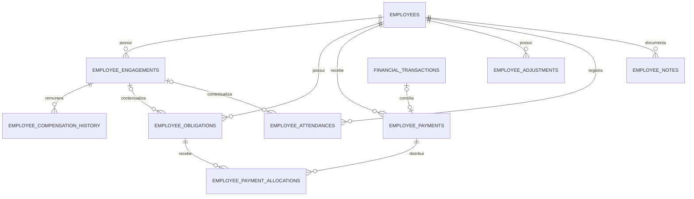
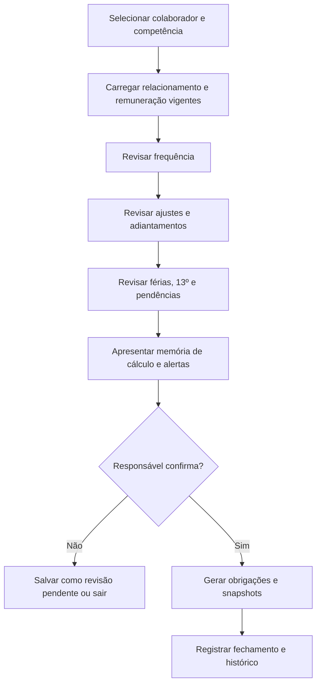
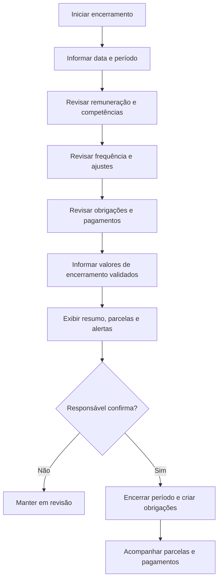

# Employees — proposta de estrutura técnica e fluxos

> **Status: proposta arquitetural para discussão — novembro de 2026.**
>
> Este arquivo complementa o README do módulo Employees. Ele descreve uma possível organização de banco de dados, backend, frontend, consultas e fluxos. Os nomes de entidades, campos, endpoints e pastas são referências de trabalho, não um schema ou contrato de API aprovado. A definição final deve ocorrer antes da implementação e após nova leitura do código atual.

## 1. Direção arquitetural

O módulo deve seguir a arquitetura já utilizada no Blue Admin, sem introduzir um padrão paralelo.

Contexto técnico existente:
- Backend: Node.js, Express e TypeScript.
- Banco: PostgreSQL com Prisma.
- Frontend: React, Vite e TypeScript.
- Comunicação frontend/backend por API REST.
- Respostas da API no envelope padrão do projeto (message + data).
- Autenticação existente com JWT e cliente Axios centralizado.
- Queries específicas para dashboards, filtros e telas de consulta.
- Separação backend por schema, controller, routes, service, repository, queries e shared.
- Frontend organizado por módulos, com types, api, queryKeys, hooks, pages e components.

A implementação deve reutilizar os padrões reais de Services, Budgets e Vehicles, depois de inspecioná-los novamente. Não copiar cegamente nomes ou detalhes que possam ter mudado.

## 2. Banco de dados — domínio proposto

### 2.1 Visão geral das entidades candidatas

A proposta inicial considera as seguintes entidades. A separação final pode ser simplificada se a análise de operações mostrar que alguma tabela não agrega valor suficiente.

| Entidade candidata | Responsabilidade principal |
|---|---|
| employees | Cadastro pessoal/cadastral da pessoa |
| employee_engagements | Períodos de relacionamento com a empresa |
| employee_compensation_history | Histórico de remuneração e vigência |
| employee_obligations | Compromissos/valores devidos, confirmados ou em revisão |
| employee_payments | Registro de pagamentos efetivamente realizados |
| employee_payment_allocations | Distribuição dos pagamentos entre obrigações |
| employee_adjustments | Bônus, descontos, comissões, adiantamentos e outros ajustes |
| employee_attendances | Ocorrências de frequência e justificativas |
| employee_notes | Notas administrativas, caso não sejam cobertas por histórico comum |
| employee_configs | Parâmetros configuráveis, se a necessidade for confirmada |

Essa lista é uma hipótese inicial, não uma obrigação de criar dez tabelas. Em particular, employee_notes, employee_configs e employee_adjustments precisam ser avaliadas conforme os casos de uso concretos. Não criar CRUD só para preencher uma arquitetura.

### 2.2 employees

Representa a pessoa, não o vínculo atual.

Campos conceituais:
- id;
- name;
- birthDate (opcional);
- documentType/document (opcional, conforme a decisão de CPF/CNPJ);
- dados de contato;
- endereço atual, se adotado;
- observations;
- status cadastral/operacional;
- createdAt/updatedAt.

Relações conceituais:
- um employee possui vários engagements;
- um employee possui várias obrigações;
- um employee possui vários pagamentos;
- um employee possui ocorrências, ajustes e registros administrativos.

Regras:
- não guardar salário atual como fonte oficial duplicada nesta tabela;
- não usar o status cadastral como substituto do estado dos períodos de relacionamento;
- não excluir fisicamente uma pessoa se houver histórico financeiro ou operacional que precise ser preservado;
- definir unicidade e normalização de documentos somente após decidir como tratar ausência, duplicidade histórica e dados incompletos.

### 2.3 employee_engagements

Representa cada período de relacionamento entre a pessoa e a oficina.

Campos conceituais:
- id;
- employeeId;
- relationshipType (classificação administrativa);
- startDate;
- endDate (opcional);
- role/occupation (opcional);
- compensationFrequency ou modalidade (se fizer sentido no domínio);
- contractReference/documentReference (opcional);
- status;
- terminationReason (opcional);
- notes;
- createdAt/updatedAt.

Relacionamentos:
- employee pertence a vários engagements;
- engagement pode ter vários registros de remuneração;
- engagement pode ser referenciado por obrigações, ajustes e ocorrências.

Regras:
- permitir vários períodos ao longo do tempo;
- impedir períodos duplicados ou sobrepostos quando a regra de negócio exigir;
- não inferir natureza jurídica pela enumeração relationshipType;
- endDate encerra aquele período, não o cadastro pessoal;
- não presumir que todo período tenha contrato ou documento anexado.

A regra para múltiplos períodos simultaneamente ativos ainda precisa ser decidida. A aplicação não deve bloquear um cenário legítimo sem antes validar o uso real.

### 2.4 employee_compensation_history

Representa os valores e condições de remuneração ao longo do tempo.

Campos conceituais:
- id;
- employeeEngagementId;
- amount;
- frequency/unit;
- effectiveFrom;
- effectiveUntil (opcional);
- reason;
- notes;
- recordedAt/createdAt;
- recordedBy (opcional, se houver relação confiável com usuário).

Pontos importantes:
- effectiveFrom/effectiveUntil representam a vigência;
- recordedAt representa quando o sistema recebeu a informação;
- registros retroativos são permitidos;
- não manter um salário atual duplicado como autoridade em employees;
- alterações que cruzem competências encerradas devem gerar sinalização e revisão;
- histórico não deve ser reescrito para esconder o valor anterior.

Antes da implementação, decidir como representar remuneração variável, por produção, por hora, diária ou múltiplos componentes. Não assumir que todo colaborador possui um único valor mensal fixo.

### 2.5 employee_obligations

Representa o compromisso financeiro individual.

Campos conceituais:
- id;
- employeeId;
- employeeEngagementId (opcional);
- type;
- description;
- competenceStart/competenceEnd ou campo de competência equivalente;
- dueDate (opcional);
- originalAmount;
- confirmationStatus/provenance;
- financialStatus, preferencialmente derivado;
- sourceType/sourceReference;
- calculationSnapshot (opcional, estruturado e versionado);
- notes;
- createdAt/updatedAt;
- confirmedAt/confirmedBy, quando aplicável.

Tipos iniciais possíveis:
- remuneration;
- thirteenth_salary;
- vacation;
- termination;
- bonus;
- commission;
- advance;
- manual_adjustment;
- other.

Os valores acima são identificadores conceituais. A enumeração final deve usar o padrão já adotado pelo projeto e ter tradução no frontend.

**Separar confirmação de situação financeira:**
- confirmação/proveniência responde “quão confiável é esta informação?”;
- situação financeira responde “quanto já foi pago e quanto resta?”;
- uma obrigação não confirmada não deve compor o saldo confirmado a pagar;
- o saldo deve ser calculado por originalAmount menos alocações válidas;
- cancelamento deve preservar justificativa e histórico;
- obrigações com pagamentos/alocações não podem ser simplesmente excluídas.

Estados financeiros possíveis para apresentação:
- aguardando confirmação;
- em aberto;
- parcialmente paga;
- paga;
- vencida;
- cancelada.

Esses estados precisam ser derivados de forma consistente. Por exemplo, “vencida” depende de saldo positivo, data de vencimento e regra de data/hora; “cancelada” não deve continuar aparecendo como valor a pagar.

### 2.6 employee_payments

Representa o pagamento que efetivamente ocorreu, independentemente de como será distribuído.

Campos conceituais:
- id;
- employeeId;
- employeeEngagementId (opcional);
- paymentDate;
- amount;
- paymentMethod (opcional);
- reference/receiptReference (opcional);
- financialTransactionId (opcional ou obrigatório conforme a estratégia aprovada);
- confirmation/provenance;
- notes;
- createdAt/updatedAt;
- reversedAt/reversalReason ou estratégia equivalente de estorno.

Regras:
- pagamento é um fato financeiro, não uma obrigação;
- permitir pagamento sem alocação somente se o fluxo de conciliação for explicitamente suportado;
- evitar duplicidade de transação;
- depois de confirmado, não permitir edição/exclusão simples que apague o fato;
- correção deve ocorrer por estorno/reversão ou registro compensatório, com justificativa e trilha de auditoria;
- a estratégia de vínculo com FinancialTransaction deve ser definida antes do schema.

### 2.7 employee_payment_allocations

Representa quanto de um pagamento foi destinado a uma obrigação.

Campos conceituais:
- id;
- employeePaymentId;
- employeeObligationId;
- amount;
- createdAt;
- createdBy (opcional).

Relações:
- um pagamento pode possuir várias alocações;
- uma obrigação pode receber várias alocações.

Restrições essenciais:
- amount deve ser positivo;
- soma das alocações ativas não pode superar o valor disponível do pagamento;
- soma das alocações ativas não pode superar o saldo da obrigação;
- pagamento e obrigação precisam pertencer ao mesmo colaborador;
- alocação deve ser feita em transação de banco com proteção contra concorrência;
- correção de alocação deve preservar o histórico, não apagar silenciosamente uma distribuição confirmada.

Exemplo:
- obrigação A: R$ 1.000,00;
- obrigação B: R$ 725,50;
- pagamento: R$ 1.200,00;
- alocação A: R$ 1.000,00;
- alocação B: R$ 200,00;
- saldo da obrigação B: R$ 525,50.

A modelagem deve suportar tanto uma parcela de uma obrigação quanto um pagamento que cubra várias obrigações.

### 2.8 employee_adjustments

Registra ajustes que podem influenciar uma obrigação, mas não substitui a obrigação nem a ocorrência que motivou o ajuste.

Campos conceituais:
- id;
- employeeId;
- employeeEngagementId (opcional);
- attendanceId (opcional, se houver relação);
- type (bonus, commission, advance, discount, correction etc.);
- direction (positive/negative) ou convenção equivalente;
- amount;
- competence;
- effectiveDate;
- description/reason;
- reviewStatus;
- appliedToObligationId (opcional, se a decisão de aplicação for explícita);
- createdAt/updatedAt.

Regras:
- toda consequência financeira deve ter motivo;
- ajuste sugerido não é ajuste confirmado;
- não criar desconto automaticamente a partir de uma ocorrência;
- impedir aplicação duplicada do mesmo ajuste;
- manter o registro original se houver correção;
- definir se ajustes serão agregados no fechamento da competência ou convertidos em obrigações separadas.

### 2.9 employee_attendances

Registra eventos de frequência, não valores financeiros.

Campos conceituais:
- id;
- employeeId;
- employeeEngagementId;
- eventType (absence, lateness, early_departure, overtime, leave etc.);
- startAt/endAt ou eventDate/duration conforme o tipo;
- justification;
- status/reviewStatus;
- notes;
- createdAt/updatedAt.

Regras:
- ocorrência não gera desconto automaticamente;
- justificativa e revisão devem ser possíveis;
- hora extra/ausência não deve alterar remuneração sem uma regra e confirmação específicas;
- correções precisam preservar o histórico quando já tiverem sido consideradas em uma competência.

### 2.10 employee_notes e employee_configs

**Notas:** avaliar se uma tabela própria é necessária ou se eventos administrativos/histórico geral cobrem o caso. Se existir, deve ter autor, data, conteúdo e escopo, com política de edição/exclusão clara.

**Configurações:** evitar uma tabela genérica e ampla antes de conhecer as regras. Se necessária, separar:
- parâmetros gerais do módulo;
- parâmetros por tipo de relacionamento;
- exceções por colaborador;
- vigência dos parâmetros;
- versão/snapshot dos parâmetros usados em cada cálculo.

Uma mudança de configuração nunca deve reescrever obrigações antigas. O snapshot aplicado precisa permanecer consultável.

## 3. Relações conceituais

Diagrama simplificado, sujeito à validação:



O diagrama apresenta cardinalidades conceituais. A relação com FinancialTransaction pode ser implementada por FK real ou por referência controlada, dependendo das restrições e dos padrões do financeiro atual. Não assumir que originType/originId cria uma relação Prisma.

## 4. Regras de exclusão, correção e integridade

### 4.1 Exclusão

- Colaborador com histórico relevante não deve ser removido fisicamente como operação comum.
- Encerrar relacionamento é diferente de excluir colaborador.
- Obrigação com pagamento/alocação não pode ser apagada.
- Pagamento confirmado não pode desaparecer por exclusão simples.
- Histórico de alterações financeiras deve permanecer auditável.
- Notas e registros sem impacto financeiro podem ter política própria, mas precisam ser avaliados.

A preferência deve ser por arquivamento, cancelamento ou encerramento com justificativa, conforme o tipo de dado.

### 4.2 Correções

- Obrigação ainda sem pagamento pode ser corrigida com histórico.
- Obrigação parcialmente paga exige reconciliação antes de alterar valor.
- Pagamento confirmado exige estorno/correção rastreável.
- Alocação confirmada exige reversão controlada.
- Alteração retroativa de remuneração deve apontar competências potencialmente afetadas.
- Reprocessamento de competência exige ação explícita e preservação da versão anterior.

### 4.3 Atomicidade financeira

Criação de pagamento, transação financeira e alocação devem ser consistentes.

A operação precisa avaliar:
1. validar colaborador e valores;
2. validar obrigações e saldos;
3. criar ou vincular FinancialTransaction;
4. criar EmployeePayment;
5. criar as alocações;
6. confirmar tudo na mesma transação Prisma, quando possível;
7. em caso de falha, reverter todas as alterações do fluxo.

Se a arquitetura atual impedir atomicidade entre alguma etapa, documentar mecanismo de reconciliação e evitar estados parcialmente concluídos sem alerta.

## 5. Backend — organização proposta

A estrutura abaixo é ilustrativa e deve ser ajustada à organização real do diretório backend.

```text
backend/
  prisma/
    schema.prisma
    migrations/
  src/
    modules/
      employees/
        employees.schema.ts
        employees.controller.ts
        employees.routes.ts
        employees.service.ts
        employees.repository.ts
        employees.shared.ts
        employees.queries.ts
        employees.types.ts
        employees.validators.ts
```

Se o projeto atual mantém os módulos em outra estrutura de diretórios, seguir a estrutura existente em vez de criar modules/ artificialmente.

### 5.1 Responsabilidades

- **schema / validators:** validação de entrada e parâmetros com Zod, respeitando os padrões existentes.
- **routes:** declarar endpoints e middlewares.
- **controller:** extrair dados da requisição, chamar service/query e montar resposta padrão.
- **service:** regras de negócio, autorização contextual, transações e orquestração.
- **repository:** operações Prisma focadas em persistência.
- **queries:** consultas de leitura e agregações para dashboard, filtros e detalhe.
- **shared/types:** enums, tipos, helpers e contratos realmente compartilhados.

Não colocar regra financeira complexa no controller. Não duplicar validação importante apenas no frontend. Evitar try/catch genérico em cada controller se o tratamento central de erros do projeto já resolve o fluxo. Respeitar o strict TypeScript e não introduzir any sem necessidade.

### 5.2 Operações de escrita candidatas

A lista final deve ser decidida por entidade e caso de uso, evitando endpoints redundantes.

| Área | Operações esperadas |
|---|---|
| Colaborador | criar, editar dados, consultar, arquivar/reativar conforme regra |
| Relacionamento | iniciar, editar dados, encerrar, consultar períodos |
| Remuneração | registrar novo valor, corrigir vigência com justificativa, consultar histórico |
| Obrigação | criar manualmente, confirmar, editar com regras, cancelar, consultar |
| Pagamento | registrar, vincular transação financeira, estornar/corrigir |
| Alocação | alocar, dividir, reverter alocação |
| Ajuste | registrar, revisar/confirmar, corrigir/cancelar |
| Frequência | registrar, editar com histórico, justificar/revisar |
| Competência | pré-visualizar, revisar, confirmar fechamento, consultar histórico |
| Encerramento | simular/revisar valores, confirmar fechamento e parcelas |

Nem toda linha precisa virar um CRUD completo. Fluxos que dependem de várias entidades devem ser operações de domínio específicas.

### 5.3 Queries de leitura candidatas

1. **Dashboard:** totais de colaboradores, obrigações confirmadas em aberto/vencidas, próximos vencimentos, pagamentos recentes e pendências de reconciliação.
2. **Lista de colaboradores:** filtros por nome/documento/status/relacionamento, paginação e resumo enxuto.
3. **Detalhe do colaborador:** cadastro, relacionamentos, remuneração, resumo financeiro, pendências e histórico.
4. **Obrigações por filtros:** competência, vencimento, tipo, estado, colaborador e faixa de valor.
5. **Pagamentos por filtros:** período, colaborador, meio, situação de conciliação e transação vinculada.
6. **Histórico de remuneração:** intervalo de vigência e data de registro.
7. **Frequência por filtros:** período, evento, justificativa e estado de revisão.
8. **Prévia de competência:** remuneração aplicável, ocorrências, ajustes, compromissos e alertas sem gravar obrigações.
9. **Prévia de encerramento:** resumo de itens e valores informados/revisados, sem confirmar lançamentos.
10. **Reconciliação histórica:** itens desconhecidos, estimados, sem evidência ou aguardando confirmação.

Queries de dashboard não devem trazer coleções completas de histórico. Usar selects explícitos, agregações no banco quando apropriado, paginação e índices compatíveis com os filtros reais.

### 5.4 Endpoints — rascunho

Exemplos de organização REST, sujeitos ao padrão atual de rotas:

| Recurso | Endpoint ilustrativo | Uso |
|---|---|---|
| Colaboradores | GET /employees | Lista paginada |
| Colaboradores | POST /employees | Cadastro |
| Colaborador | GET /employees/:employeeId | Detalhe |
| Colaborador | PATCH /employees/:employeeId | Dados cadastrais |
| Relacionamentos | POST /employees/:employeeId/engagements | Novo período |
| Remuneração | POST /employees/engagements/:engagementId/compensations | Registrar remuneração |
| Obrigações | GET /employees/obligations | Filtros |
| Obrigações | POST /employees/obligations | Registro manual |
| Pagamentos | POST /employees/:employeeId/payments | Registrar pagamento |
| Alocações | POST /employees/payments/:paymentId/allocations | Distribuir pagamento |
| Ajustes | POST /employees/:employeeId/adjustments | Registrar ajuste |
| Frequência | POST /employees/:employeeId/attendances | Registrar ocorrência |
| Dashboard | GET /employees/queries/dashboard | Resumo |
| Detalhe | GET /employees/queries/find-employee-by-id/:employeeId | Visão consolidada |
| Competência | POST /employees/queries/preview-competence | Simulação sem gravação |
| Encerramento | POST /employees/queries/preview-termination | Simulação sem confirmação |

O endpoint de prévia é uma consulta/ação sem efeito financeiro persistido. Confirmação de competência e encerramento devem ser operações explícitas e protegidas, não um efeito colateral de abrir a tela.

## 6. Frontend — organização proposta

A estrutura ilustrativa deve acompanhar o padrão dos módulos já existentes em frontend/src/modules.

```text
frontend/src/modules/employees/
  employees.types.ts
  employees.api.ts
  employees.queryKeys.ts
  employees.hooks.ts
  pages/
    EmployeesDashboard.tsx
    EmployeeDetails.tsx
  components/
    EmployeeForm/
    EmployeeFilters/
    EmployeeSummary/
    EmployeeEngagements/
    EmployeeCompensationHistory/
    EmployeeObligations/
    EmployeePayments/
    EmployeeAdjustments/
    EmployeeAttendances/
    EmployeeNotes/
    CompetenceReview/
    TerminationReview/
    HistoricalReconciliation/
```

Os nomes e a divisão dos componentes podem mudar. Evitar criar um arquivo por campo ou componente sem responsabilidade real.

### 6.1 Dashboard

Deve priorizar:
- seletor de período quando necessário;
- quantidade de colaboradores ativos;
- obrigações confirmadas em aberto e vencidas;
- próximos vencimentos;
- pagamentos recentes;
- alertas de competência/revisão;
- histórico incompleto e pendências de reconciliação;
- acesso rápido para cadastrar colaborador e registrar operação relevante.

Estimativas e dados desconhecidos devem ficar em uma seção separada dos totais confirmados.

### 6.2 Cadastro e edição

O formulário deve permitir salvar cadastro parcial, desde que os campos realmente essenciais estejam presentes. Dados pessoais, relacionamento e remuneração não devem ser obrigados a caber em um único formulário gigante.

Uma sequência possível:
1. dados pessoais;
2. período de relacionamento (opcional na criação, conforme caso);
3. remuneração inicial (opcional);
4. revisão de dados pendentes.

A interface deve informar o que está incompleto sem bloquear o usuário por campos históricos desconhecidos.

### 6.3 Detalhe do colaborador

Organização sugerida:
- cabeçalho com nome e situação;
- resumo financeiro confirmado;
- pendências históricas/reconciliação em bloco separado;
- dados pessoais;
- relacionamentos e períodos;
- remuneração histórica;
- obrigações e pagamentos;
- férias/13º e compromissos especiais;
- frequência e ajustes;
- observações e histórico.

Não apresentar um único saldo que misture dívida confirmada, estimativa e informação desconhecida.

### 6.4 Componentes financeiros

- Exibir valor original, total alocado, saldo e situação.
- Identificar claramente pagamentos parciais.
- Permitir visualizar a quais obrigações um pagamento foi alocado.
- Exibir a transação financeira vinculada quando existir.
- Exigir confirmação em operações irreversíveis ou que afetem saldos.
- Apresentar justificativa para cancelamento, estorno ou correção.

### 6.5 Padrão visual e interação

Seguir a linguagem já adotada nos módulos Services, Budgets e Vehicles:
- layout responsivo;
- hierarquia visual clara;
- espaçamento e tipografia consistentes;
- CSS variables e componentes reutilizáveis existentes;
- popups/modais e fluxos em etapas quando isso simplificar a operação;
- estados de loading, vazio, erro e sucesso;
- filtros recolhíveis quando apropriado;
- evitar excesso de cards e fundos decorativos;
- manter textos em português;
- não expor detalhes técnicos de enums ao usuário.

Dados pessoais e financeiros devem ser apresentados com cuidado. Máscaras de documento não substituem proteção no backend.

## 7. Fluxos de ponta a ponta

### 7.1 Cadastro de colaborador atual ou histórico

1. Abrir cadastro.
2. Informar dados pessoais conhecidos.
3. Salvar mesmo que informações secundárias estejam ausentes.
4. Adicionar um período de relacionamento, se conhecido.
5. Registrar remuneração com sua data real de vigência.
6. Se a data ou o valor forem aproximados, marcar a informação como estimada/informada, não confirmada.
7. Registrar obrigações e pagamentos históricos apenas quando houver informação suficiente.
8. Encaminhar o que faltar para reconciliação posterior.

O cadastro não deve forçar a criação de uma obrigação financeira inicial.

### 7.2 Alteração de remuneração

1. Selecionar o período de relacionamento.
2. Informar novo valor/modalidade.
3. Informar a data efetiva em que a mudança passou a valer.
4. Registrar a data de lançamento automaticamente.
5. Exigir motivo/observação conforme a operação.
6. Verificar se a vigência se sobrepõe a outro registro.
7. Identificar competências e obrigações potencialmente afetadas.
8. Salvar sem alterar obrigações anteriores automaticamente.
9. Se houver recálculo, abrir fluxo de revisão específico e guardar snapshot anterior.

### 7.3 Fechamento de competência



A prévia não deve gravar obrigações. A confirmação deve validar novamente os dados no backend para evitar que uma tela desatualizada gere valores incorretos.

### 7.4 Registrar pagamento e alocar

1. Selecionar colaborador.
2. Informar data, valor e meio/referência.
3. Selecionar uma ou mais obrigações ou deixar em conciliação, se permitido.
4. Validar valor disponível e saldos.
5. Criar/vincular transação financeira.
6. Registrar pagamento e alocações em operação atômica.
7. Atualizar consultas e saldos.
8. Exibir comprovante/referência e distribuição do valor.

Exemplo de regra: não permitir alocar R$ 800,00 se o saldo da obrigação for R$ 700,00, nem alocar R$ 1.100,00 de um pagamento de R$ 1.000,00.

### 7.5 Corrigir ou estornar pagamento

1. Abrir o pagamento original.
2. Exibir transação e alocações.
3. Solicitar motivo.
4. Informar a correção/estorno de forma explícita.
5. Preservar o pagamento original e o histórico.
6. Reconciliar as alocações e a transação financeira.
7. Recalcular os saldos derivados.
8. Atualizar dashboard e detalhe.

Não oferecer exclusão simples para pagamento confirmado.

### 7.6 Registrar falta ou atraso

1. Selecionar colaborador e período de relacionamento.
2. Registrar tipo, data/duração e justificativa.
3. Salvar como ocorrência.
4. Exibir na frequência da competência.
5. Se houver decisão de consequência financeira, iniciar um ajuste separado.
6. Exigir motivo, revisão e confirmação antes de refletir o ajuste em obrigação.

### 7.7 Encerrar relacionamento



A etapa de confirmação não substitui validação contábil/jurídica. O sistema deve permitir informar valores revisados manualmente e não presumir regras legais.

### 7.8 Reconciliação de histórico antigo

1. Listar registros desconhecidos, estimados ou pendentes.
2. Exibir pessoa, período, tipo de informação e origem.
3. Permitir confirmar, corrigir, manter estimado ou marcar como desconhecido.
4. Exigir justificativa em correções relevantes.
5. Não converter automaticamente o registro em dívida ou pagamento.
6. Atualizar os totais confirmados apenas depois da confirmação adequada.

## 8. Índices, consultas e performance

Índices candidatos, sujeitos aos filtros reais:
- engagements por employeeId, status e intervalo de datas;
- compensation history por engagementId e effectiveFrom/effectiveUntil;
- obligations por employeeId, status, type, dueDate e competência;
- payments por employeeId e paymentDate;
- allocations por paymentId e obligationId;
- attendances por employeeId e data;
- adjustments por employeeId e competência.

Evitar criar todos os índices sem validar plano de consulta e cardinalidade. Datas de competência precisam de uma representação consistente para que filtros mensais não dependam de comparações frágeis de texto.

Para dashboard:
- usar agregações no banco;
- limitar pagamentos recentes;
- paginar listas;
- selecionar apenas campos necessários;
- separar consulta resumida da consulta detalhada;
- garantir que pendências e estimativas não contaminem totais confirmados.

## 9. Validações essenciais no backend

- valores monetários positivos ou não negativos conforme o tipo de operação;
- precisão e escala Decimal adequadas ao padrão financeiro atual;
- datas de vigência coerentes;
- fim de relacionamento não anterior ao início;
- competência válida;
- colaborador/relacionamento coerentes entre si;
- pagamento e obrigação pertencentes ao mesmo colaborador;
- soma de alocações dentro dos limites;
- não duplicar transação financeira;
- exigir motivo em estorno, cancelamento e correção;
- não aplicar ajuste duas vezes;
- não gerar obrigação a partir de simulação;
- não alterar período encerrado sem fluxo explícito;
- respeitar autenticação e permissões.

O frontend pode antecipar mensagens de validação, mas o backend deve ser a autoridade final.

## 10. Testes esperados

### Banco/repositório/serviço
- criar colaborador com dados parciais;
- criar mais de um período de relacionamento;
- rejeitar ou sinalizar vigências conflitantes conforme a regra aprovada;
- registrar remuneração retroativa;
- preservar histórico após alteração;
- criar obrigação confirmada e pendente;
- não incluir estimativas nos saldos confirmados;
- alocar pagamento parcial;
- dividir um pagamento entre obrigações;
- rejeitar alocação acima do saldo;
- rejeitar alocação acima do pagamento;
- rejeitar alocação entre colaboradores diferentes;
- garantir rollback quando falhar a integração financeira;
- estornar pagamento sem apagar o original;
- registrar frequência sem gerar desconto;
- fechar competência somente após confirmação;
- sinalizar impacto de remuneração retroativa;
- encerrar relacionamento sem apagar dados anteriores.

### Queries
- dashboard com dados confirmados e pendentes separados;
- filtros por colaborador, relacionamento, competência e status;
- detalhe com histórico ordenado;
- saldo por obrigação correto após pagamentos parciais;
- paginação e limites;
- nenhuma exposição desnecessária de documento/endereço;
- consultas sem duplicar valores por joins um-para-muitos.

### Frontend
- loading, erro, vazio e sucesso;
- formulário parcial;
- mensagens de validação;
- distinção visual entre confirmado/estimado/desconhecido;
- confirmação antes de gerar obrigações;
- pagamento dividido e parcial;
- revisão de estorno/cancelamento;
- layout responsivo;
- atualização/invalidação correta das query keys.

## 11. Ordem sugerida de implementação

A ordem abaixo reduz risco e evita começar pelos cálculos mais delicados.

1. **Revisão de arquitetura:** conferir diretórios, padrões atuais, autenticação, financeiro, schema e histórico de commits.
2. **Fechamento do domínio:** decidir entidades definitivas, campos, estados, relações, exclusões e operações.
3. **Schema Prisma:** criar somente modelos e relações aprovados; revisar migration antes de aplicar.
4. **Base cadastral:** employees, engagements e remuneração histórica.
5. **Leituras iniciais:** lista, filtros, detalhe e dashboard cadastral.
6. **Obrigações:** criação manual, confirmação, edição/cancelamento e consultas.
7. **Pagamentos/alocações:** integração transacional com FinancialTransaction e testes de integridade.
8. **Ajustes e frequência:** ocorrências sem desconto automático; ajustes revisados.
9. **Reconciliação histórica:** estados de confiança e pendências.
10. **Competência e encerramento assistidos:** prévia, memória de cálculo, confirmação e snapshots.
11. **Refinamento:** permissões, auditoria, performance e preparação para integrações futuras.

Cada etapa deve ser pequena, revisada e testada antes de avançar. Não é necessário criar todas as entidades no primeiro migration se o fluxo inicial puder ser entregue com um núcleo menor e consistente.

## 12. Decisões que precisam ser fechadas antes do Prisma

Checklist de arquitetura:
- [ ] Campos obrigatórios e opcionais de employees.
- [ ] Política de CPF/CNPJ e unicidade.
- [ ] Endereço atual versus histórico de endereço.
- [ ] Tipos administrativos de relacionamento.
- [ ] Regra para períodos simultâneos e recontratação.
- [ ] Modalidades de remuneração e remuneração variável.
- [ ] Estados de confirmação/proveniência.
- [ ] Tipos e estados de obrigações.
- [ ] Representação da competência.
- [ ] Regras para cancelamento e correção de obrigações.
- [ ] Estratégia de estorno de pagamentos.
- [ ] Cardinalidade e atomicidade com FinancialTransaction.
- [ ] Política de alocação sem obrigação prévia.
- [ ] Tipos de ajustes e momento em que afetam obrigação.
- [ ] Estrutura de frequência e justificativas.
- [ ] Configurações e snapshots de cálculo.
- [ ] Histórico/auditoria e identificação do responsável.
- [ ] Permissões para dados pessoais e financeiros.
- [ ] Escopo da primeira entrega.

---

**Diretriz técnica:** primeiro modelar corretamente os fatos e suas relações; depois implementar as operações; por último automatizar cálculos. O módulo deve continuar confiável mesmo quando o usuário optar por fazer tudo manualmente.
